  

  
  

 

  <picture>
    <source
      media="(prefers-color-scheme: dark)"
      srcset="https://raw.githubusercontent.com/daudonhere/daudonhere/output/pacman-contribution-graph-dark.svg"
    />
    <source
      media="(prefers-color-scheme: light)"
      srcset="https://raw.githubusercontent.com/daudonhere/daudonhere/output/pacman-contribution-graph.svg"
    />
    
  </picture>

 

  

 

  

